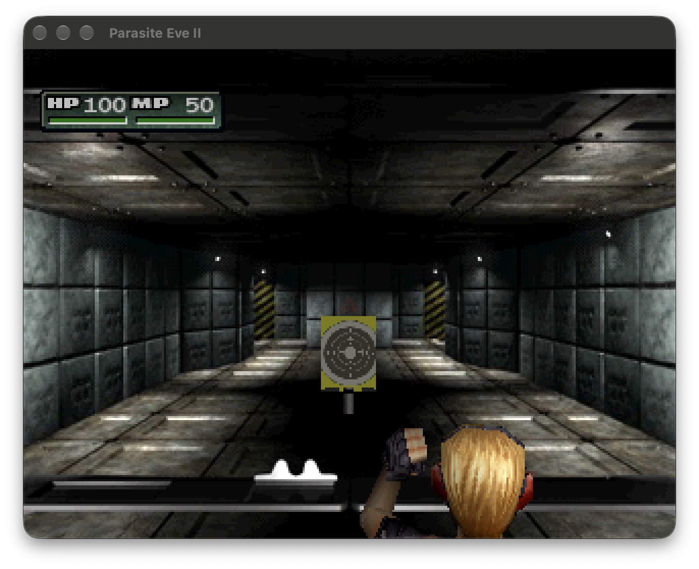

# Parasite Eve II — native PC port

[](https://github.com/khasinski/parasite-eve-ii-pc/actions/workflows/pc.yml)

A native PC port of *Parasite Eve II* (PlayStation, USA release), built from the matching decompilation of the
original game code and [our PsyZ fork](https://github.com/khasinski/parasite-eve-psyz), a drop-in replacement for the
PlayStation runtime library (Psy-Q) on top of SDL3. It follows the architecture of
[parasite-eve-pc](https://github.com/khasinski/parasite-eve-pc), our port of the first game.



## Status

**Pre-alpha. There is no release yet and nothing to download.** The game boots from your disc images and plays the
opening movie, the title screen and New Game. Recorded New Game input reaches the Acropolis helicopter landing pad,
including No. 9 combat and transformer damage. Boss completion and the later story are unverified.

Known limits:

- Only the Akropolis stage and a few packages are linked. Dryfield, the Neo Ark and the later stages need the overlay
  module registry (phase 2 in [docs/PORT_PLAN.md](docs/PORT_PLAN.md)); attract demos are disabled until then.
- Audio, movies and saves are incomplete.
- Tested on macOS (arm64) only. Linux is built and its host tests run in CI; Windows is untested.
- The host menu has Graphics (detail, aspect, dithering, geometry correction, fullscreen, antialiasing, model filtering, smooth lighting), Controls, Audio and Discs pages; widescreen, frame interpolation, HD packs and mods are not there yet (the first game's port has them).

## What you need

Your own **North American CUE/BIN images of both discs**. Game data is not included and never will be: the port reads
your discs at run time.

Nothing else: the build uses committed layout sources (types, sizes, decoders; no game data) and the game reads the
discs when it starts. The tools that extract data from a disc are only for contributors (see below).

## Build

Requires Git, CMake 3.21 or newer and a C11 compiler.

```sh
git clone https://github.com/khasinski/parasite-eve-ii-pc
cd parasite-eve-ii-pc
git submodule update --init third_party/psyz
git -C third_party/psyz submodule update --init external/SDL
cmake -S . -B build -DCMAKE_BUILD_TYPE=RelWithDebInfo
cmake --build build --parallel
./build/parasite-eve-ii-pc "path/to/Parasite Eve II (Disc 1).cue"
```

Put the second disc next to the first (or pick it when the game asks for it). You can also set `PE2_DISC` instead of
passing the path. Host tests: `cmake --build build --target host_tests && ctest --test-dir build`. Nothing from your
disc is ever committed: `tools/ci/check_no_game_data.sh` enforces that.

**Contributors:** the layout sources are committed and the extraction tooling (splat split, `ninja_config.py`, disc
extraction) is no longer in the tree. If a generator change needs them regenerated, check out the tag
`pe2-layout-tooling` in a separate worktree, run its `tools/port/refresh_layout.sh` there with your images in `rom/image/`,
and copy the result back (see [docs/PORT_PLAN.md](docs/PORT_PLAN.md)).

### Development switches

| Variable | Effect |
| --- | --- |
| `PE2_SKIPINTRO=1` | skip the opening movie |
| `PE2_DUMP_VRAM=<tick>:<file>` | write the raw VRAM once at that pad tick; `tools/port/export_vram.py` turns it into a PNG (no screen capture needed) |
| `PE2_DUMP_MENU=<file.ppm>` | write the painted host menu (`--host-menu`) as a PPM, for review without a screen capture |
| `PE2_WARP=<tick>:stage,area,view,roomState,warp,variant[;<tick>:...]` | change stage during play at that pad tick (the session-start path a stage change takes); up to 8, separated by `;` |
| `PE2_START_LOCATION=stage,area,view,roomState,warp,variant` | new game starts there (stages 1-5; needs the overlays for it) |
| `PE2_FAST=1` | no frame limiter during movies |
| `PE2_AUTOPRESS=<tick>` | scripted Start/Cross from that tick |
| `PE2_PAD_REPLAY=<file>` / `PE2_PAD_RECORD=<file>` | replay or record input (see `tools/port/make_gallery_input.py`) |
| `PE2_DUMP_ASSETS=<file>` | hash every runtime-loaded array (compare with `-DPE_EMBED_ASSETS=ON`) |

## How it is built

- The original game code is compiled natively with a host C11 compiler and linked against PsyZ. It is neither an
  emulator nor a static recompiler.
- The port is one-way: byte-matching the PS1 binaries is not a goal. Compiler workarounds from the decompilation
  (register pins, scheduling barriers, declaration order for the linker) are removed as the code is repaired.
- Game data is loaded from the disc images at run time. Disc records (32-bit offsets and addresses) are decoded into
  host structures; pointers are never stored in 32-bit fields ([docs/SIZE_AUDIT.md](docs/SIZE_AUDIT.md)).
- Overlays are linked statically with explicit state and reset.

More in [docs/PORT_PLAN.md](docs/PORT_PLAN.md) (phases and notes), [docs/RUNTIME_ASSETS.md](docs/RUNTIME_ASSETS.md)
(runtime asset loading) and [CONTRIBUTING.md](CONTRIBUTING.md).

## Acknowledgements

This port would not exist without the work of others:

- **[GabeRealB/parasite-eve-2-decomp](https://github.com/GabeRealB/parasite-eve-2-decomp)** — the matching
  decompilation of *Parasite Eve II* that all game code in this repository comes from, together with its documentation
  of the game's formats and systems and its asset tooling (`tools/peassets`). This repository started as a copy of
  that project and keeps its history; the decompilation is released under CC0. Its original README and project notes
  are kept in [docs/decomp/](docs/decomp/).
- **[PsyZ](https://github.com/Xeeynamo/psyz)** by Xeeynamo, and our
  [fork](https://github.com/khasinski/parasite-eve-psyz), which provide the PSY-Q compatible runtime. PsyZ builds on
  the [sotn-decomp](https://github.com/Xeeynamo/sotn-decomp) PSY-Q work and
  [Sozud's PSY-Q decomp](https://github.com/sozud/psy-q-decomp).
- **[parasite-eve-pc](https://github.com/khasinski/parasite-eve-pc)** — the port of the first game, whose architecture
  and conventions this project follows.

See [THIRD_PARTY_NOTICES.md](THIRD_PARTY_NOTICES.md) for licenses.

*Parasite Eve* is a trademark of Square Enix. This is an unofficial fan project and is not affiliated with or endorsed
by Square Enix. The screenshots show the game running from the author's own discs.

## License

Project code is released under [CC0 1.0](LICENSE), as the decompilation it is derived from. Game assets and the game's
copyrighted content are not included and remain the property of their owners. PsyZ and its dependencies carry their own
licenses (see `third_party/psyz` and [THIRD_PARTY_NOTICES.md](THIRD_PARTY_NOTICES.md)).
